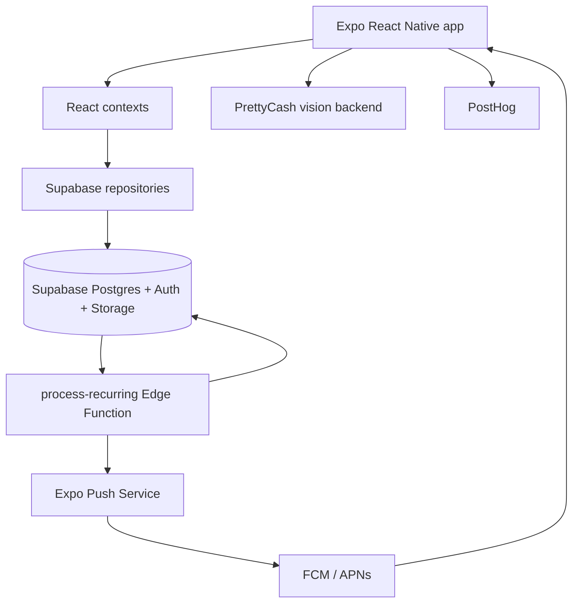

# PrettyCash Architecture

Implementation status: Living document; reflects the current Expo SDK 58 / Supabase implementation.

Related indexes: [[plans-index|Plans]] · [[specs-index|Specs]] · [[01-native-google-signin|Learning 01 — Native Google Sign-In]]

## 1. Purpose

PrettyCash is a mobile-first personal finance app for tracking expenses and income, scanning receipts with AI, viewing monthly insights, managing categories, and scheduling recurring transactions.

This architecture describes the system from the outside in:

- runtime shell and navigation,
- authentication and identity,
- Supabase persistence and repositories,
- feature modules and their boundaries,
- receipt-analysis and recurring-transaction workflows,
- deployment, security, analytics, and testing concerns.

## 2. System at a glance

| Layer | Technology | Responsibility |
|---|---|---|
| Mobile client | Expo SDK 58, React Native, TypeScript | UI, navigation, local state, device APIs |
| UI state | React Context + hooks | Auth, theme, currency, month, categories, transactions, pending recurring confirmations |
| Backend data | Supabase Postgres/Auth/Storage | Users, profiles, categories, transactions, receipts, recurring schedules |
| Receipt AI | PrettyCash backend + vision API | Receipt extraction, categorization, async analysis jobs |
| Scheduled jobs | Supabase Edge Function + Cron | Recurring transaction processing |
| Push delivery | Expo Push → FCM (Android) / APNs (iOS) | Month-end confirmation notifications |
| Analytics | PostHog | Screen tracking, identity, feature events |
| Builds | EAS Build | Development clients, native Google Sign-In, notifications, credentials |

## 3. Runtime topology



## 4. Module map

| # | Module | Architecture | Primary plans | Primary specs |
|---|---|---|---|---|
| 01 | App foundation | [[01-app-foundation]] | [[2026-09-10-prettycash-main-pages]] · [[2026-09-20-dark-mode]] | [[2026-09-10-expo-migration-design]] · [[2026-09-10-prettycash-main-pages-design]] · [[2026-09-18-premium-polish-design]] · [[2026-09-20-dark-mode-design]] |
| 02 | Authentication and identity | [[02-authentication]] | [[2026-09-16-hide-login-anonymous-auth]] · [[2026-10-31-native-google-signin]] | [[2026-09-16-hide-login-anonymous-auth-design]] · [[2026-10-31-native-google-signin-design]] |
| 03 | Data platform | [[03-data-platform]] | [[2026-09-13-supabase-auth-database]] · [[2026-09-16-home-insights-db-data]] | [[2026-09-13-supabase-auth-database-design]] · [[2026-09-16-home-insights-db-data-design]] |
| 04 | Home dashboard | [[04-home]] | [[2026-09-17-home-month-picker]] · [[2026-09-18-hide-show-balance]] | [[2026-09-17-home-month-picker-design]] · [[2026-09-18-hide-show-balance-design]] |
| 05 | Transactions | [[05-transactions]] | [[2026-09-18-editable-transactions]] · [[2026-10-24-split-add-button]] | [[2026-09-18-editable-transactions-design]] · [[2026-10-24-split-add-button-design]] |
| 06 | Receipts and AI | [[06-receipts-ai]] | [[2026-09-13-add-transaction-ai-receipt]] · [[2026-09-18-receipt-date-and-receipt-data]] · [[2026-10-24-auto-categorization]] · [[2026-10-24-receipt-analysis-retry]] · [[2026-10-25-analyzing-stages]] | [[2026-09-13-add-transaction-ai-receipt-design]] · [[2026-09-13-async-receipt-analysis-design]] · [[2026-09-18-receipt-date-and-receipt-data-design]] · [[2026-10-24-auto-categorization-design]] · [[2026-10-24-receipt-analysis-retry-design]] · [[2026-10-25-analyzing-stages-design]] |
| 07 | Insights | [[07-insights]] | [[2026-09-12-insights-screen]] · [[2026-09-18-insights-combined-donut]] | [[2026-09-12-insights-screen-design]] · [[2026-09-18-insights-combined-donut-design]] · [[2026-09-18-insights-long-lists-design]] |
| 08 | Categories | [[08-categories]] | [[2026-09-12-categories-screen]] | [[2026-09-12-categories-screen-design]] |
| 09 | Profile and recurring | [[09-profile-recurring]] | [[2026-09-12-profile-and-recurring]] · [[2026-10-31-recurring-transactions-edge-function]] | [[2026-09-12-profile-and-recurring-design]] · [[2026-10-31-recurring-transactions-edge-function-design]] |

## 5. Core runtime flows

### 5.1 Startup

1. `App.tsx` loads DM Sans fonts.
2. `ThemeProvider` resolves the system/user theme.
3. `CurrencyProvider` supplies the selected currency.
4. `AuthProvider` restores the Supabase session.
5. `Gate` shows the login screen when no session exists.
6. `Bootstrap` loads the profile, seeds default categories, and stores settings.
7. `CategoriesProvider` and `TransactionsProvider` load user data.
8. `PendingRecurringProvider` loads pending month-end confirmations.
9. Navigation shows Home, Insights, Categories, and Profile.
10. Device timezone and Expo push token are synchronized.

### 5.2 Authentication

- Browser OAuth remains for web and Facebook.
- Native Google uses the Google SDK and `supabase.auth.signInWithIdToken`.
- Email OTP uses a deep link back into the app.
- Auth state is propagated through `AuthProvider`; PostHog identity is synchronized from the Supabase user.

### 5.3 Transaction write

1. A transaction is entered via the add sheet or receipt flow.
2. `TransactionsContext` calls the transactions repository.
3. Supabase inserts the transaction and optional line items.
4. Local context state updates immediately; derived groups and totals recompute.

### 5.4 Receipt analysis

1. The user takes or picks a receipt image.
2. The image is uploaded/base64-encoded to the PrettyCash vision backend.
3. The app polls or receives an async analysis result.
4. The extracted merchant, amount, date, items, and category prefill the transaction form.
5. Retry and idempotency protect against duplicate jobs and recovery failures.

### 5.5 Recurring transactions

1. Recurring items store a local-time day of month and an optional category ID.
2. An hourly Supabase Cron job calls the `process-recurring` Edge Function.
3. The function computes the user’s local date from their IANA timezone.
4. Normal due dates post transactions automatically.
5. If the configured day does not exist in that month, the function creates a pending occurrence and sends a push notification.
6. The app displays a confirmation modal; the user posts the transaction on the last valid day or skips the month.

## 6. Cross-cutting concerns

### Security and secrets

- Supabase RLS protects every row by `user_id`.
- Edge Functions use the service role only server-side.
- Firebase service-account keys and EAS credentials are never committed.
- `EXPO_PUBLIC_*` values are public by definition and must not contain secrets.

### Reliability

- Repositories surface Supabase errors to feature contexts.
- Auth and session failures have retry surfaces.
- Receipt jobs are idempotent and retryable.
- Recurring occurrences use a unique `(recurring_item_id, occurrence_date)` ledger to prevent duplicates.

### Observability

- PostHog tracks screens and identity.
- Feature events cover categories, transactions, receipts, and recurring items.
- Edge Function results return posted/pending/pushed/failed counts.

### Testing

- Jest + jest-expo for the client and pure utilities.
- Pure recurrence logic tests cover timezone, leap years, and month-end clamping.
- EAS builds verify native modules and push credentials.

## 7. Documentation convention

The numbered folders are intentionally aligned across all three documentation sets:

```text
docs/architecture/NN-module.md
docs/plans/NN-module/*.md
docs/specs/NN-module/*.md
```

The same number always means the same module. Obsidian wikilinks connect architecture notes, plans, and specs without depending on relative paths.

## 8. Implementation status

Implementation status: Living document. Architecture documentation is current as of 2026-10-31; update it when modules, boundaries, or data flows change.
