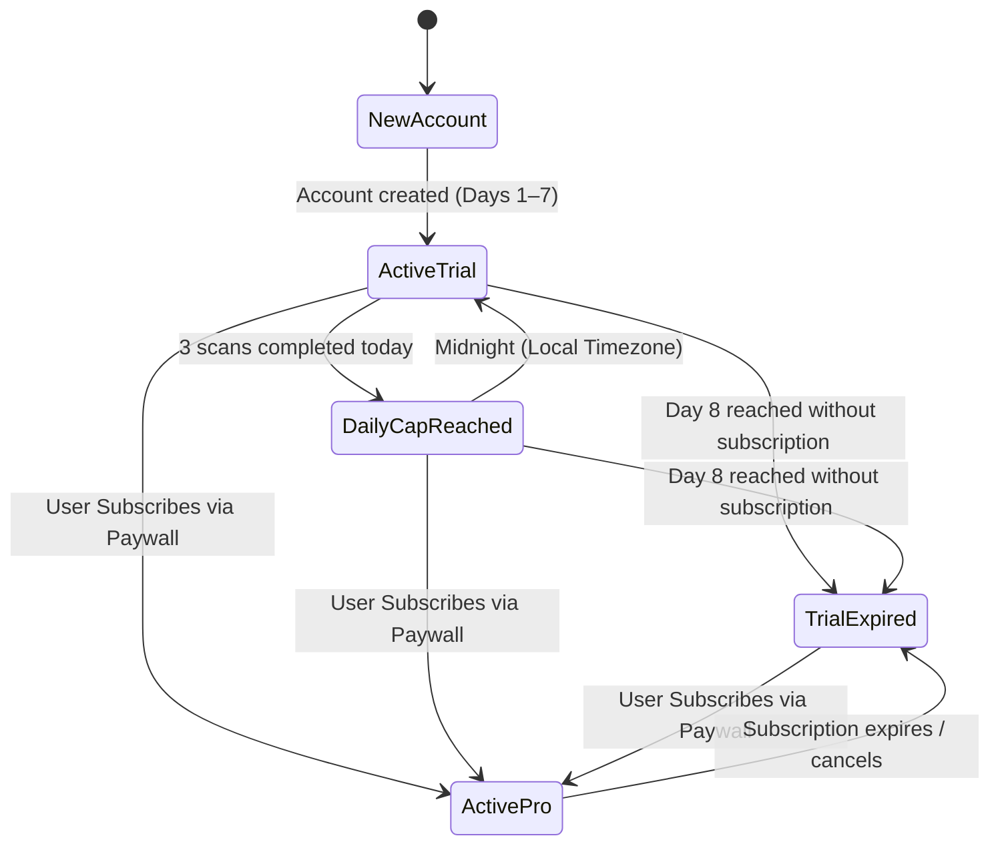

# RevenueCat Subscriptions & 7-Day AI Trial Design

**Date:** 2026-11-10  
**Status:** Approved  
**Implementation status:** Core frontend and backend implementation complete; RevenueCat credentials, Play products, backend deployment, EAS build, and device verification pending.

---

## Related Documents

- Architecture: [[docs/architecture/10-subscriptions|10 — Subscriptions Architecture]]
- Frontend Specs Index: [[docs/specs/specs-index|Specs Index]]
- Frontend Plans Index: [[docs/plans/plans-index|Plans Index]]
- Backend Architecture: `PrettyCash-Backend/docs/prettycash-backend-architecture/ARCHITECTURE.md`
- Backend PostHog LLM Observability Spec: `PrettyCash-Backend/docs/specs/02-ai-providers/2026-10-31-posthog-llm-observability-design.md`

---

## 1. Executive Summary & Product Model

PrettyCash introduces **PrettyCash Pro**, unlocking unlimited AI receipt scanning. Manual expense tracking remains **100% free forever**.

### Commercial Rules
1. **Free Tier (Post-Trial):** 0 AI receipt scans. Unlimited manual expense and income tracking.
2. **New Accounts (First 7 Days):** Automatic App-Managed Trial granting **up to 3 AI receipt scans per day**. No credit card required upfront.
3. **PrettyCash Pro Subscribers:** Unlimited AI receipt scans, zero daily caps. Available via **Monthly** and **Annual** auto-renewing subscriptions managed through **RevenueCat**.

---

## 2. Subscription Products & Entitlements

| Store Product ID | RevenueCat Package Identifier | Duration | Trial on Google Play | Post-Trial / Pro Entitlement |
| :--- | :--- | :--- | :--- | :--- |
| `monthly` | `$rc_monthly` | 1 Month | Off (0 days)* | Unlimited AI Receipt Scans |
| `yearly` | `$rc_annual` | 1 Year | Off (0 days)* | Unlimited AI Receipt Scans |

*\*Note on Google Play Trials:* The 7-day trial is app-managed upfront so users can test the camera immediately upon registration without payment friction. Google Play Console trials remain disabled to prevent an unintended "double trial" (7 days free in-app + another 7 days on Google Play).

### Entitlements
- **`pro`**: The single RevenueCat entitlement unlocking unlimited AI receipt scans across all platforms.

---

## 3. Quota & Gating Logic

### User State Machine



### State Definitions

1. **State 1: Active Trial (`inTrial == true && dailyScansUsed < 3`)**
   - Camera action in `SplitAddButton` launches camera / gallery picker immediately.
   - Banner / badge displays in `AddTransactionSheet` and `ProfileScreen`:
     > *"Free Trial: {N} days left • {M} scans left today"*
2. **State 2: Daily Trial Cap Reached (`inTrial == true && dailyScansUsed >= 3`)**
   - Tapping camera button opens the **Daily Limit Sheet**:
     > *"Daily Trial Limit Reached: You've used your 3 free scans for today. Resets tomorrow at midnight, or upgrade to PrettyCash Pro now for unlimited scans."*
   - Offers two buttons: **"Upgrade to Pro"** (opens Paywall) and **"Enter Manually"**.
3. **State 3: Trial Expired / Free User (`inTrial == false && isPro == false`)**
   - Tapping camera button immediately opens the **Pro Paywall Modal**.
   - Manual expense tracking continues unrestricted.
4. **State 4: Active Pro (`isPro == true`)**
   - Camera action launches immediately with no scan caps and no trial badges.
   - Profile displays a distinct **"Pro"** status badge.

### Timezone Consideration
Daily scan resets occur at **00:00 (midnight) in the user's local timezone** (derived from `profiles.timezone`), ensuring users get their fresh 3 scans according to their local calendar day.

---

## 4. Frontend Architecture (React Native / Expo)

### A. Dependencies
- `react-native-purchases`: Official RevenueCat React Native SDK.
- Config plugin added to `app.json` / `app.config.ts`.
- Built via EAS Development Build (`expo run:android` / EAS Build). *Not supported in Expo Go.*

### B. `SubscriptionContext` (`src/context/SubscriptionContext.tsx`)
- **Initialization:**
  ```ts
  Purchases.configure({
    apiKey: Platform.select({
      android: process.env.EXPO_PUBLIC_REVENUECAT_GOOGLE_API_KEY,
      ios: process.env.EXPO_PUBLIC_REVENUECAT_APPLE_API_KEY,
    })!,
    appUserID: supabaseUser.id,
  });
  ```
- **State Management:**
  - `isPro`: `boolean` (derived from `customerInfo.entitlements.active['prettycash_pro'] !== undefined`).
  - `trialDaysLeft`: `number` (calculated as `7 - daysSince(profile.created_at)`).
  - `isTrialActive`: `boolean` (`trialDaysLeft > 0 && !isPro`).
  - `dailyScansUsed`: `number` (fetched from daily scan tracking).
  - `dailyScansLimit`: `3`.
  - `canScan`: `boolean` (`isPro || (isTrialActive && dailyScansUsed < 3)`).
  - `offerings`: RevenueCat current offering containing Monthly and Annual packages with localized prices (`pkg.product.priceString`).
- **Actions:**
  - `purchasePackage(packageToBuy)`: Launches native Google Play checkout via RevenueCat.
  - `restorePurchases()`: Syncs existing store transactions across devices.
  - `recordScanAttempt()`: Increments today's local scan counter.

### C. Pro Paywall Modal (`src/components/ProPaywallModal.tsx`)
Styled natively to match PrettyCash's design tokens (DM Sans, brand green, clean typography):
- **Header:** Close button (`✕`), "PrettyCash Pro" badge.
- **Hero:** *"Unlock Unlimited AI Receipt Scanning"*
- **Feature Comparison:**
  - Manual tracking: Free forever
  - AI Receipt Scanner: Unlimited with Pro (Trial: 3/day)
  - Insights & Categories: Free
- **Plan Cards:**
  - **Annual Card:** Best value callout with annualized monthly breakdown.
  - **Monthly Card:** Standard monthly billing.
- **CTA:** *"Continue"* button triggering `purchasePackage()`.
- **Compliance Disclosures:**
  > *"Subscriptions auto-renew until canceled in Google Play Store settings. You can manage or cancel your subscription anytime."*
- **Links:** Direct external links to Privacy Policy and Terms of Service.
- **Restore:** "Restore Purchases" text button.

### D. Developer Simulator Menu
To test every user scenario without waiting 7 days or executing real credit card transactions, a **Developer Simulation Panel** is included (available in Profile when `__DEV__` or `dev_login_off` is enabled):
- Button 1: **"Simulate: Fresh Trial (3 scans left)"**
- Button 2: **"Simulate: Trial Daily Cap Reached (0 scans left)"**
- Button 3: **"Simulate: Trial Expired (Show Paywall)"**
- Button 4: **"Simulate: Active Pro Subscriber"**

---

## 5. Backend & Database Architecture

### A. Supabase Database Schema
1. **`profiles` update:**
   - `is_pro`: `boolean default false` (cached entitlement).
   - `pro_source`: `text` (`'revenuecat'`, `'manual'`).
2. **`scan_usage` table:**
   - `id`: `uuid primary key default gen_random_uuid()`
   - `user_id`: `uuid references auth.users(id) on delete cascade`
   - `usage_date`: `date not null` (local calendar date)
   - `scan_count`: `integer default 0`
   - Constraint: `unique(user_id, usage_date)`

### B. FastAPI Quota Enforcement (`PrettyCash-Backend`)
In `app/api/v1/receipt.py` (`POST /api/v1/analyze-receipt`):
- Checks authenticated user identity from Supabase JWT.
- Verifies scan permission before enqueueing image to Gemini worker:
  1. If `user.is_pro == true`: **Allow**.
  2. If `user` is in 7-day trial window:
     - Check `scan_usage` for today:
     - If `count < 3`: Increment `scan_usage.scan_count` atomically, **Allow**.
     - If `count >= 3`: Return HTTP 403 `{"error": {"code": "DAILY_TRIAL_LIMIT_REACHED", "message": "Daily trial limit reached. Up to 3 scans/day."}}`.
  3. If trial expired:
     - Return HTTP 403 `{"error": {"code": "SUBSCRIPTION_REQUIRED", "message": "Free trial expired. Subscribe to PrettyCash Pro."}}`.

### C. RevenueCat Webhook Integration
- Endpoint: `POST /api/v1/billing/revenuecat/webhook` (FastAPI)
- Secured via secret authorization header `Authorization: Bearer <REVENUECAT_WEBHOOK_AUTH_TOKEN>`.
- Events Handled:
  - `INITIAL_PURCHASE` / `RENEWAL` / `UNCANCELLATION`: Sets `profiles.is_pro = true`.
  - `EXPIRATION` / `BILLING_ISSUE`: Sets `profiles.is_pro = false`.

---

## 6. What You Need to Do After Implementation (Your Step-by-Step Checklist)

Once the code is implemented, follow these steps to connect real store billing:

### Step 1: Create Products in Google Play Console
1. Navigate to **Google Play Console** → Select `PrettyCash`.
2. Go to **Monetize** → **Products** → **Subscriptions**.
3. Click **Create subscription**:
   - **Subscription name:** `PrettyCash Pro`
   - **Subscription ID:** `prettycash_pro`
4. Create two Base Plans under this subscription:
   - **Base Plan 1:**
     - Base Plan ID: `monthly`
     - Type: Auto-renewing
     - Billing period: 1 Month
     - Price: Set your desired monthly price (e.g., $4.99 USD)
     - Free trial toggle: **Leave OFF** (app provides the 7 days free upfront).
   - **Base Plan 2:**
     - Base Plan ID: `yearly`
     - Type: Auto-renewing
     - Billing period: 1 Year
     - Price: Set your desired annual price (e.g., $39.99 USD)
     - Free trial toggle: **Leave OFF**.
5. Click **Activate** on both Base Plans.

### Step 2: Set Up License Testing in Google Play Console
1. Go to **Setup** → **License testing**.
2. Add your testing Gmail address(es) to the license testers list.
3. Set **License test response** to `RESPOND_NORMALLY`.
   *(This ensures that whenever you make a test purchase in your development build, Google Play shows a free "Test Card, Always Approves" checkout sheet without charging real money).*

### Step 3: Configure RevenueCat Dashboard
1. Go to [app.revenuecat.com](https://app.revenuecat.com/) and create a free account / project named `PrettyCash`.
2. Under **Project Settings** → **Apps**, click **+ New App** → select **Android (Google Play Store)**.
   - Enter your Android package name: `com.mohamedahshik.prettycash`.
   - Follow RevenueCat's 1-click guide to link your Google Play Service Account (for validating purchases).
3. Under **Product Menu**:
   - Go to **Entitlements** → Click **+ New Entitlement**:
     - Identifier: `pro`
     - Description: `PrettyCash Pro Unlimited AI`
   - Go to **Offerings** → Click **+ New Offering** (Identifier: `default`):
     - Attach Package `$rc_monthly` → map to `monthly`.
     - Attach Package `$rc_annual` → map to `yearly`.
   - Attach both to the `prettycash_pro` entitlement.
4. Go to **Project Settings** → **API Keys**:
   - Copy the **Public Google API Key** (starts with `goog_...`).
   - Paste it into your `.env`:
     ```text
     EXPO_PUBLIC_REVENUECAT_GOOGLE_API_KEY=goog_xxxxxxxxxxxxxxxxxxxxxxxxx
     ```
5. *(Optional for real-time webhooks)*:
   - Under **Integrations** → **Webhooks**, paste your public backend webhook URL:
     `https://your-backend.com/api/v1/billing/revenuecat/webhook`
   - Set the shared authorization header token.

### Step 4: Build & Install New Development Build
Because `react-native-purchases` includes native Android Google Play Billing libraries, build a fresh EAS development APK:
```bash
npx eas-cli build --profile development --platform android
```
Download and install the APK on your Android test phone.

### Step 5: Verification on Device
1. Launch the app and verify the **Developer Simulator Menu** switches between all 4 states instantly.
2. Select **"Simulate: Trial Expired"**, tap the camera to open the Paywall.
3. Tap **"Continue"** on Monthly or Annual.
4. Verify the native Google Play bottom sheet opens showing **"Test Card, Always Approves"**.
5. Complete purchase and verify Pro status unlocks immediately.

---

## 7. Implementation Deliverables

1. **Frontend:**
   - `react-native-purchases` installation & Expo configuration.
   - `src/context/SubscriptionContext.tsx`
   - `src/components/ProPaywallModal.tsx`
   - Camera gating & trial countdown in `src/components/SplitAddButton.tsx` and `src/components/AddTransactionSheet.tsx`.
   - Developer Simulator in `src/screens/ProfileScreen.tsx`.
   - Unit tests for trial calculations and paywall rendering.
2. **Database:**
   - Migration for `profiles.is_pro` and `scan_usage` table with RLS.
3. **Backend (`PrettyCash-Backend`):**
   - Quota enforcement middleware in `app/api/v1/receipt.py`.
   - RevenueCat webhook handler in `app/api/v1/billing.py`.
   - Backend unit tests for quota limits.
